# Tech Hub | Mobile Accessories Website

*A Google Sites-based academic project showcasing mobile accessories through a structured and visually engaging website.*

---

## Project Overview

Tech Hub is a mobile accessories website developed as a first-year academic project using Google Sites. The website presents a range of technology products, including power banks, wireless earbuds, chargers, mobile cases, smartwatches and other accessories.

The project focuses on organising product information, presenting product visuals and creating a simple browsing experience for visitors.
## Live Website

Explore the published website:

[Visit Tech Hub – Mobile Accessories](https://sites.google.com/view/6023mobileaccessories/home)
## Website Preview

### Home Page

| Hero Section | New Arrivals |
|:---:|:---:|
| 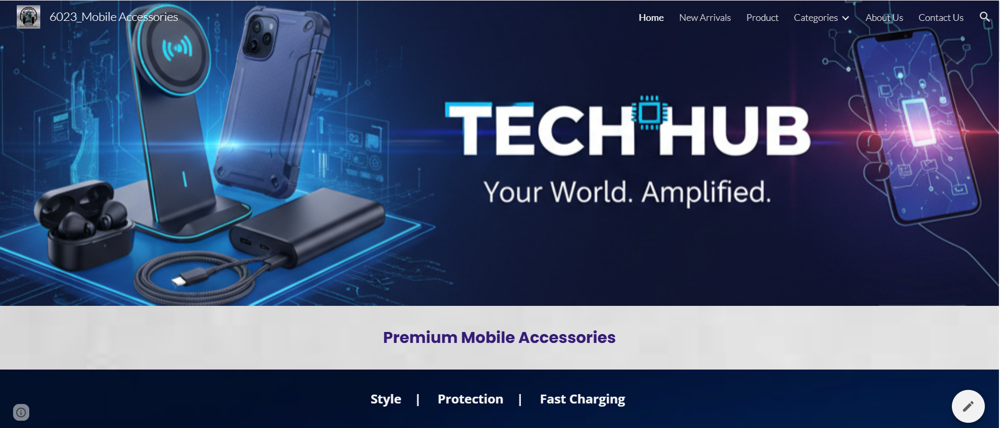 | 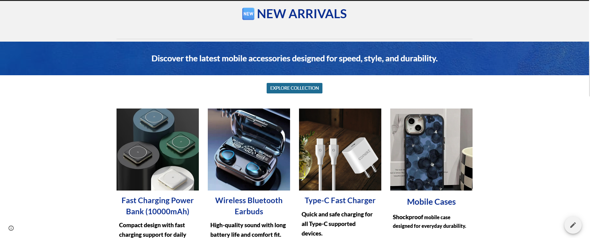 |

### Product Page

| Main Product Section | Product Details |
|:---:|:---:|
| 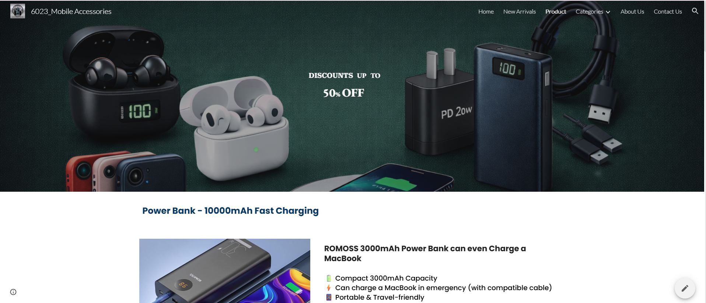 | 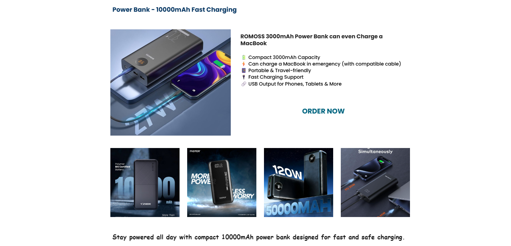 |
### About Us Page

| Main Section | Details 1 | Details 2 |
|:---:|:---:|:---:|
| 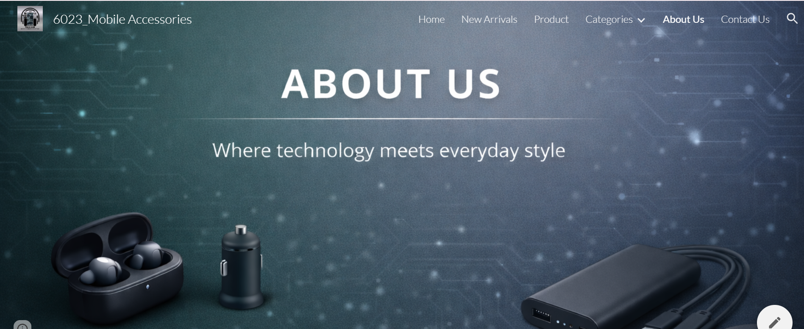 | 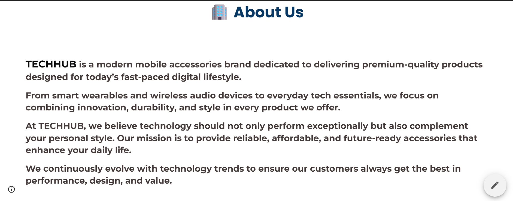 | 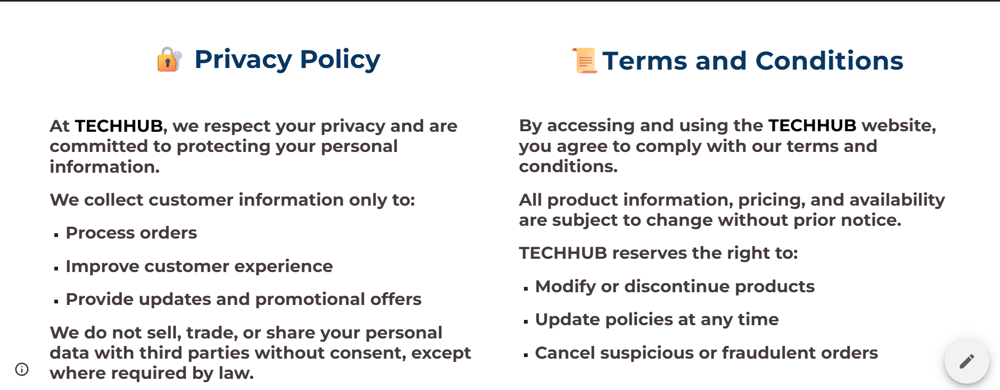 |
### Categories Page

The categories section organises mobile accessories into different product categories, making it easier for visitors to browse the website.

| Category Banner | Products – Section 1 | Products – Section 2 |
|:---:|:---:|:---:|
| 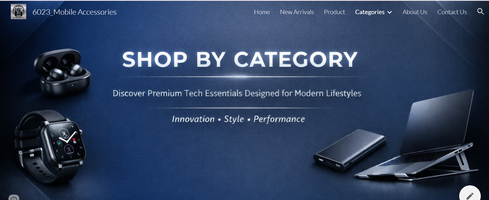 | 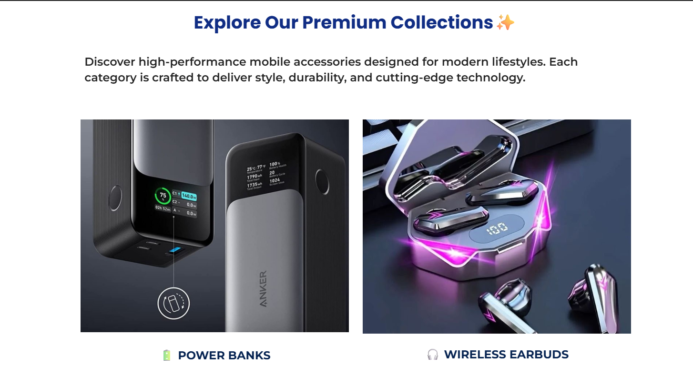 | 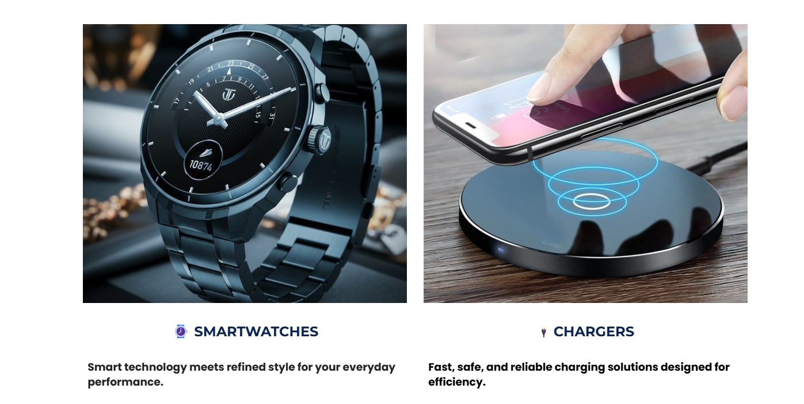 |
### Contact Us Page

The Contact Us page provides visitors with contact information and a form to make enquiries.

| Main Banner | Contact Details | Contact Form |
|:---:|:---:|:---:|
| 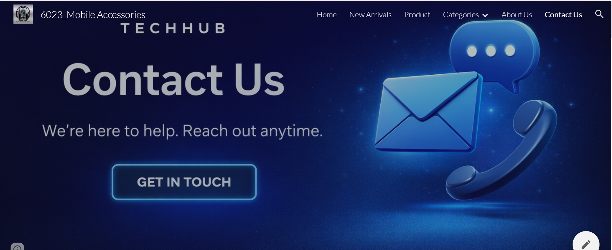 | 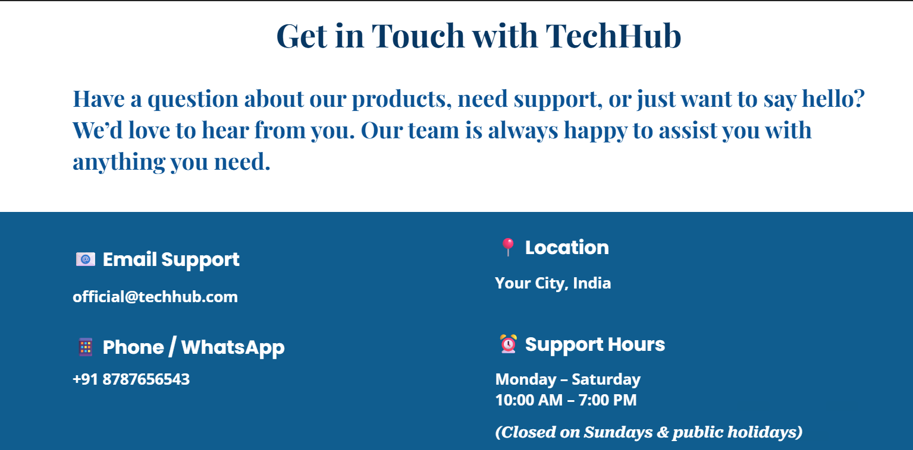 | 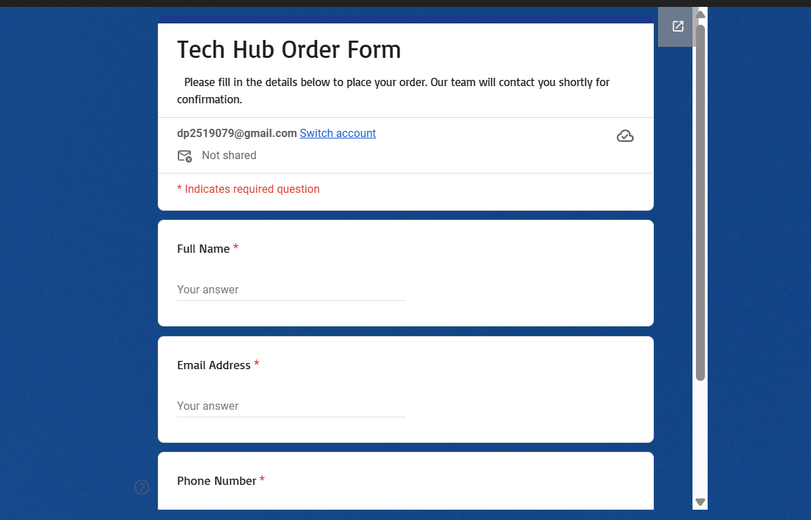 |
## Key Sections and Features

- **Home Page:** Brand introduction, promotional banner and featured products.
- **New Arrivals:** Visual showcase of recently added accessories.
- **Product Pages:** Product images, descriptions, features and pricing.
- **Categories:** Organised navigation for different accessory types.
- **About Us:** Brand introduction and company information.
- **Policies:** Warranty, privacy policy and terms and conditions.
- **Contact Information:** Business contact details.

## Project Objectives

- Build an organised website to showcase mobile accessories.
- Present product information in a clear and accessible format.
- Arrange products into relevant categories.
- Create informative sections for visitors.
- Develop practical experience in website creation and content organisation.

## Tools and Platform

| Tool | Purpose |
|---|---|
| Google Sites | Website creation and page organisation |
| Product Images | Visual presentation of accessories |
| Content Design | Product descriptions and website information |

## Skills Demonstrated

- Website creation using Google Sites
- Content organisation
- Visual presentation
- Page structure and navigation
- Basic website design

## Project Information

| Detail | Description |
|---|---|
| Project Name | Tech Hub – Mobile Accessories |
| Project Type | Academic Project |
| Academic Year | First Year |
| Platform | Google Sites |
| Development Approach | No-code website creation |

---

*This project was an early opportunity to explore website structure, digital presentation and online product showcasing.*
